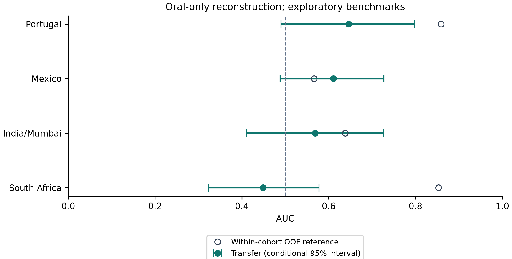

# Oral Microbiome Transfer

**Can an oral-microbiome model trained in one collection of studies transfer to another?**
This repository accompanies a retrospective audit of diabetes-status prediction:
checking specimen eligibility, overlapping studies, evaluation procedures and the
conclusions that survive those checks.

**[Explore the research website](https://oralbiome.scarpelli.ai/)** ·
[Read the paper](https://oralbiome.scarpelli.ai/preprint) ·
[Download the PDF](https://oralbiome.scarpelli.ai/preprint.pdf) ·
[Code and reproduction guide](https://oralbiome.scarpelli.ai/code)

> **Erratum, 2026-11-17.** The archived v2026.11.15 paper
> (`studies/cross-population-t2d/docs/Preprint.*`) and `ARCHIVE_README.md` still
> call the paper and code "private". That wording is outdated: the paper, the
> 59-file code archive and this repository are public; only the original
> research repository and its Git/LFS history remain private. The corrected
> manuscript is at <https://oralbiome.scarpelli.ai/preprint> (revision
> 2026-11-17; release-status wording and statistic labels only, no reported
> number changed). The archived files are left byte-identical on purpose.

> Exploratory working manuscript; not peer reviewed. All evaluation cohorts
> informed development. This work does not establish a clinical screening tool
> or independently confirmed transfer performance.

## The result at a glance



The four transfer intervals include chance. The within-cohort references are
different fitted models, not clinical ceilings. Uncertainty is conditional on
the observed specimens and fitted scores; it omits unresolved participant
clustering and model-development uncertainty. See the paper for the estimands.

## Start here

| You want to… | Open |
|---|---|
| Understand the study and browse its results | [Research dashboard](https://oralbiome.scarpelli.ai/) |
| Read the methods, findings and limitations | [Paper](https://oralbiome.scarpelli.ai/preprint) |
| Check which finding is supported by which artifact | [Evidence ledger](studies/cross-population-t2d/docs/Audit_Evidence.json) |
| Inspect the numerical analysis | [Analysis scripts](studies/cross-population-t2d/scripts/) |
| Inspect retained statistical outputs | [Aggregate reports](studies/cross-population-t2d/data/processed/) |
| Identify inputs needed for numerical reconstruction | [Input contract](input-contract.json) |
| Verify the repository files | [Repository manifest](MANIFEST.json) |

## What the audit contributes

- **Eligibility:** excludes 129 fecal specimens that had been labeled oral,
  retaining 10,228 source specimens.
- **Study overlap:** excludes the corresponding source studies when evaluating
  overlapping Indian runs and the related Shanghai study.
- **Evaluation:** reconstructs training-only feature selection, consistent
  permutation statistics, disjoint-row calibration and out-of-fold subgroups.
- **Interpretation:** withdraws unsupported confident-reversal and safety-remedy
  claims and keeps the less favorable corrected results.

This is an audit of our own workflow. Several corrections changed together, so
their individual effects on AUC have not been isolated. The contribution is the
documented case and executable checks, rather than a new prediction algorithm.

## Check evidence without participant data

From the repository root, using Python 3:

```sh
cd studies/cross-population-t2d
python3 -S scripts/check_audit_evidence.py
python3 -S -m unittest discover -s tests -p test_audit_evidence.py -v
```

No downloads or third-party packages are needed for these checks. They verify
file identity, claim completeness and 26 retained aggregate values across nine
findings. Deliberately incorrect fixtures exercise rejection behavior. Passing
does not independently reproduce a model result or establish clinical truth.

### Run the synthetic analysis controls

From the study directory above, with Python 3.11:

```sh
python3.11 -m venv .venv
.venv/bin/python -m pip install -r requirements-lock.txt
.venv/bin/python -m unittest discover -s tests -v
.venv/bin/python scripts/run_release_analysis.py --check-inputs
```

The tests include seven analysis controls and nine evidence-checker controls.
They do not train on participant data. The final input check intentionally exits
with status **2** while the 11 omitted historical inputs are missing; that is
the expected safeguard before numerical execution.

## Reproducibility boundary

| Available here | Not supplied or established |
|---|---|
| Reviewed analysis code, pinned Python requirements and synthetic checks | Participant-level matrices, labels and demographic linkages |
| Cohort/fold/seed/genus-level statistical summaries and provenance | Raw reads, reference databases and fitted models |
| Exact hashes and source routes for omitted historical inputs | A procedure proven to rebuild every historical input from those routes |
| Retrospective benchmark results | Untouched confirmatory evaluation or clinical utility |

Numerical reconstruction requires independently obtaining permitted, matching
historical derived inputs. Full raw-to-paper reproduction is not established.
Do not interpret hashes as access to the omitted data. Some unchanged scientific
scripts retain historical motivation in comments; the corrected paper governs
interpretation.

NHANES labels reflect self-reported diabetes rather than verified Type 2 subtype;
clinical cohorts retain heterogeneous deposited labels. Shanghai participant
linkage and its deposited/published case-count discrepancy remain unresolved.
Those limits matter when interpreting transfer.

## Release provenance, citation and licenses

This clean repository snapshot comes from the published November 15, 2026
[reviewed archive](https://oralbiome.scarpelli.ai/downloads/oralbiome-audit-836e92d5b54f.tar.gz).
Its SHA-256 is
`836e92d5b54ff2569344efe0fd191d7d054bbcb130bab41e6af2ca1ad8301248`.
Scientific scripts, paper, reports and tests retain their reviewed bytes. The
archive's original README and manifest are retained as
[ARCHIVE_README.md](ARCHIVE_README.md) and
[ARCHIVE_MANIFEST.json](ARCHIVE_MANIFEST.json); their pre-release labels record
the earlier packaging state. This README and the repository manifest describe
the current layout.

See [CITATION.cff](CITATION.cff) for attribution. The paper is a working manuscript;
no DOI or peer review is claimed. Source code uses the [MIT license](LICENSE).
Original project documentation and statistical outputs use
[CC-BY-4.0](DATA-LICENSE.md), subject to third-party restrictions. Third-party
inputs are not relicensed or redistributed here.

For additional context, figures and the current public release, visit
**[oralbiome.scarpelli.ai](https://oralbiome.scarpelli.ai/)**.
